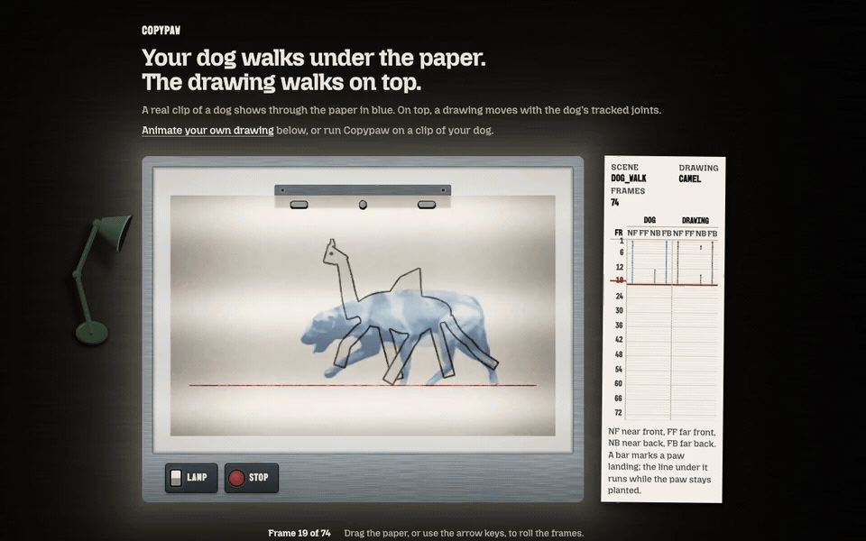

# Copypaw

Your child's creature. Your dog's walk.

Copypaw animates a four-legged drawing with motion from a side-on pet video, keeping the original strokes.

<picture>
  <source srcset="docs/hero.jpg" media="(prefers-reduced-motion: reduce)">
  
</picture>

Experimental: the drawing uses the tracked motion, but how closely it copies the pet's gait has not been measured.

**[Try your drawing](https://copypaw.intesarjawad.com/)**. The command-line version runs on a laptop CPU, without a GPU or an account.

Or install the command line:

```sh
uv tool install git+https://github.com/intesarjawad/copypaw
```

## Two ways to use it

Either way, the strokes stay the child's own: the drawing is deformed, never redrawn.

**In a browser tab.** The page rigs your drawing, lets you drag its joints and animates it with the bundled dog walk. Nothing leaves your machine. It cannot track your own pet yet, and it saves no files.

**On the command line.** Film your pet from the side and the drawing takes the tracked joint motion. Three commands take the clip to a side-by-side video and GIF:

```sh
uv run copypaw capture copypaw/selftest/dog_walk.mp4 -o out/motion
uv run copypaw rig copypaw/selftest/dragon.png -o out/dragon
uv run copypaw animate out/dragon out/motion/motion.npz --clip copypaw/selftest/dog_walk.mp4 -o out/result
```

Each step with its real output is in [docs/cli.md](docs/cli.md). For a clip that tracks well, read the [filming guide](docs/filming_guide.md).

## How it works

1. **Mask.** The drawing is separated from its page. A page that holds more than one creature stops with a message and a link to examples.
2. **Joints.** A four-legged template of 16 joints is fitted to the mask, and you can drag any joint afterwards.
3. **Mesh.** The outline becomes a triangle mesh with about 1000 interior vertices, deformed as rigidly as possible so the texture stays the drawing's.
   <!-- number: 1000 interior vertices, web/src/compute/mesh.ts MESH_INTERIOR_VERTICES -->
4. **Pet pose.** YOLOX finds the animal and ViTPose reads 17 joints per frame on the CPU. Left and right swaps are fixed, and paw contacts and the ground line are found.
5. **Retarget.** The motion is baked onto the drawing's own leg lengths, then adjusted until planted paws touch the ground.

The deformation and rendering engine is [AnimatedDrawings](https://github.com/facebookresearch/AnimatedDrawings), vendored. The full walk-through is in [docs/how_it_works.md](docs/how_it_works.md).

## Known limits

- **Gait is unmeasured.** The bundled sample measures paw-contact timing, not how closely the drawing copies a pet's gait, and no eligible gait example exists in the bundled material ([evaluation](docs/evaluation.md)).
- **Film from the side.** Front and rear views lose legs.
- **Tails are stiff.** A tail follows a share of the hind legs' swing and has no motion of its own.
- **It is slow.** See the timings below.

The rest are in [docs/limits.md](docs/limits.md).

## Speed

`uv run python scripts/bench.py --write-readme` times each stage on the packaged five-second clip in balanced mode. This run was on an Apple M5, CPU only, on 2026-11-12: single wall times on a shared machine, not performance budgets.

<!-- bench:start -->
| Measurement | Result |
| --- | --- |
| Detect, per frame | 3331.9 ms |
| Pose, per frame | 2118.1 ms |
| Identity, per frame | 2.4 ms |
| Smoothing, per frame | 0.0 ms |
| Capture, no flip test | 305.7 s |
| Capture, flip test | 401.8 s |
| Animate, including video/GIF exports | 125.1 s |
| Capture → rig → animate, cached models | 390.9 s |
| Gallery motion render | n/a |
<!-- bench:end -->

What each row includes is in [docs/evaluation.md](docs/evaluation.md).

## Run it locally

Python 3.12, 3.13 or 3.14, uv 0.13.7, and Node.js 24 with npm for source builds.

```sh
make setup
uv run copypaw doctor
uv run copypaw models fetch --mode balanced
make check
```

`models fetch` downloads the weights once and verifies each SHA-256. Rendering needs OpenGL: a graphical session on a Mac. The Linux headless fallback has not been run yet ([ADR-004](docs/adr/ADR-004.md)).

## Where it fits

AnimatedDrawings animates human figures from any motion file, and Copypaw vendors its engine. Viggle generates new video and redraws the pixels. Procreate Dreams is a full animation studio. Copypaw covers one narrow job: a four-legged drawing that keeps its strokes and takes its motion from a pet clip. [How they compare](docs/comparison.md).

## Licences

Code is MIT ([LICENSE](LICENSE)). The vendored engine and the downloaded model weights keep their own licences, and the licence of the YOLOX detector weights is unconfirmed: read [docs/licences.md](docs/licences.md) before you redistribute them. Photos and clips you process stay on your machine.

## Contributing

Read [CONTRIBUTING.md](CONTRIBUTING.md) before sending a change and [SECURITY.md](SECURITY.md) for private vulnerability reporting.
