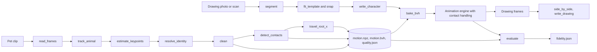
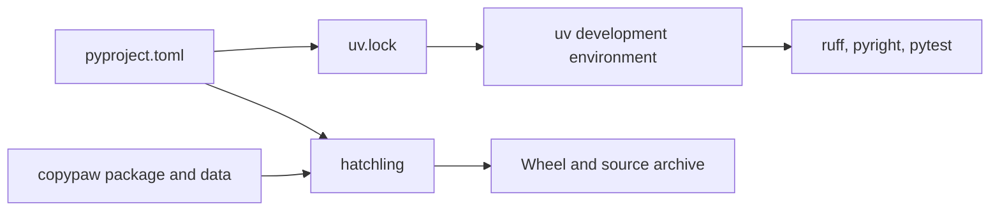

# Package and development architecture

Copypaw is a flat-layout Python package. `copypaw/__init__.py` exports
the version, and a unit test compares it with `pyproject.toml`.

## Data flow

A pet clip becomes a motion file; a drawing becomes a rigged character; the
animation engine joins the two. The `capture`, `rig` and `animate` commands each
run one part, and the local app runs all three in a session folder.

## Module map

| Package | Role |
| --- | --- |
| `copypaw.capture` | Video sampling, animal detection and tracking, pose, limb identity, cleaning, paw contacts, root travel, quality report. Public API in [api.md](api.md). |
| `copypaw.motion` | The motion archive (`motion.npz`), the fixed 14-bone skeleton and the BVH writer. Public API in [api.md](api.md). |
| `copypaw.rig` | Segment one drawing from a page, fit the four-legged template, snap legs and neck to the pixels, write the character folder and record joint edits. |
| `copypaw.animate` | Bake the motion onto the drawing's leg proportions, write the engine configs, render in a spawned process, stand planted paws on the ground, export MP4 and GIF with the footfall strip. The only package that imports the vendored engine. |
| `copypaw.evaluate` | Gait fidelity between a motion and the drawing it drives, pose accuracy (OKS AP, PCK) and identity-flip counts. |
| `copypaw.app` | The loopback server and the packaged self-test. See [privacy.md](privacy.md) for its contract. |
| `copypaw.vendor` | The animation engine and the ONNX subset of the pose runtime, with their licences. See [ADR-002](adr/ADR-002.md) and [ADR-003](adr/ADR-003.md). |
| `copypaw.cli`, `copypaw.doctor`, `copypaw.models`, `copypaw.errors` | The command line, the environment report, pinned model downloads and the shared error messages in `messages.json`. |

`scripts/` holds the maintainer tools: gallery and motion builds, evaluation,
benchmarks, goldens and the copy linter. `web/` holds the TypeScript page that
Vite builds for the site and the wheel.

Dependencies run one way: `animate` and `evaluate` read `capture` and `motion`
output, and `capture` never imports `animate`. A unit test keeps engine imports
inside `copypaw/animate/`.

## Development environment

Runtime dependencies cover CPU inference, image and video I/O, numerical work,
and OpenGL rendering. Python is bounded to 3.12 through 3.14 to match the
ONNX Runtime wheel constraint. `uv.lock` includes development dependencies and
contains no torch dependency.

Hatchling includes all files under `copypaw/`, so vendored shaders and
YAML configuration files travel with the wheel. `typings/` contains development
declarations for gaps in third-party types; the findings are recorded in
[ADR-002](adr/ADR-002.md).

`make check` runs the Python checks used by CI. CI selects unit tests without
the `slow`, `render`, or `ui` markers on Python 3.12, 3.13, and 3.14. The Linux
development container installs OSMesa for rendering.
